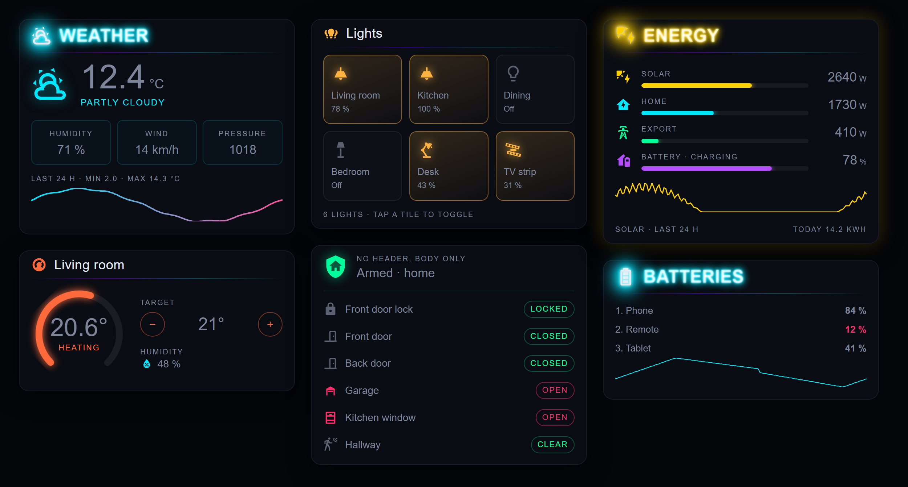
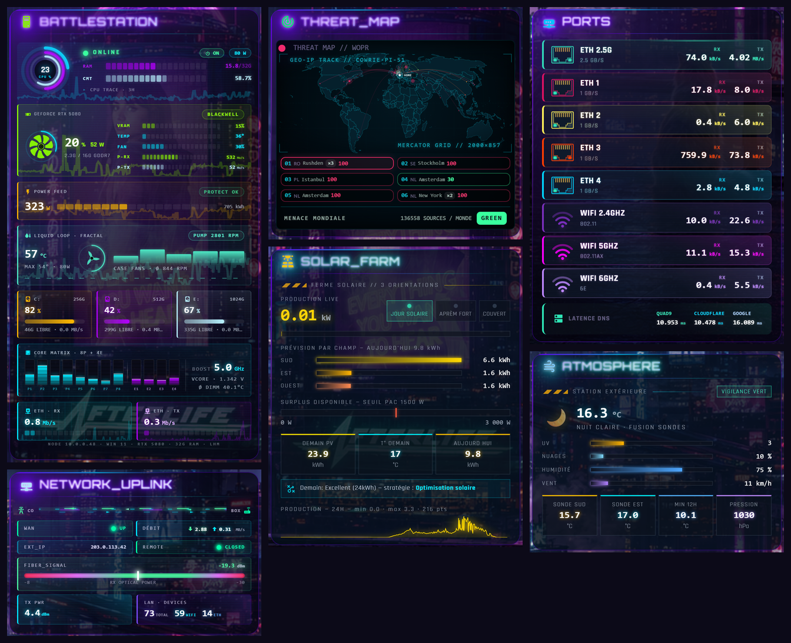
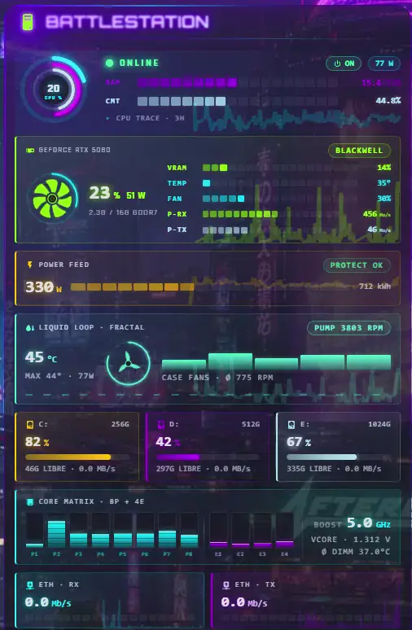
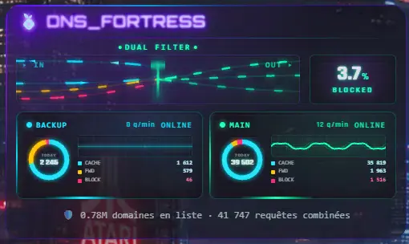

<div align="center">


**A Markdown card for Home Assistant that renders full HTML, SVG and CSS from Jinja templates in the browser, with an optional, fully customisable neon header.**

[![HACS Custom][hacs-badge]][hacs-url]
[![Release][release-badge]][release-url]
[![Validate][validate-badge]][validate-url]
[![License: MIT][license-badge]][license-url]

[](https://my.home-assistant.io/redirect/hacs_repository/?owner=cerealkiller57540&repository=neon-markdown-card&category=plugin)



</div>

Every panel above is **one `neon-markdown-card`**: no other custom card, no template sensor written for it. The body is HTML (or Markdown) with Jinja-style templates, evaluated in the browser against the live states: `` over an attribute list, ``, macros, filters, SVG sparklines from the recorder history, `<style>` blocks with `@container` queries and keyframe animations. The header on top is optional: a neon title whose icon, colours, glow, gradient, flicker and CRT scanline are all yours to set, a plain title, or no header at all.

*Weather, Energy and Batteries use a neon header, Lights and Living room a plain one, the security panel has none (`mode: body`). The YAML of each card is in [`examples/`](examples/): copy it and replace the entity ids with yours. The card ships the engine and the header, not these layouts: you write the body.*

## ✨ Features

- **Client-side template engine**: `set`, `if / elif / else`, `for` (with `loop.*` and `else`), `macro` (with keyword arguments and `` / `caller()`), `range()`, `now()`, `states()`, `state_attr()`, `states.domain.entity.attribute`, `as_timestamp()`, ternaries, `~` concatenation, Python slicing (`items[:3]`, `text[-2:]`), and about thirty filters (`round`, `int`, `default`, `sort`, `map`, `selectattr`, `sum`, `clamp`, `format`, `zfill`, `thousands`, `indent`, `slice`…). No round-trip to the server: the card only re-renders when one of the entities it reads changes.
- **Escaped by default**: `{{ expression }}` prints text. A state, an attribute or a variable that contains `<b>` shows `<b>`, it does not become markup. HTML you build on purpose goes through `|safe` or a macro (see [Upgrading to 5.0](#upgrading-to-50)).
- **Full HTML and SVG body**, sanitised: layout tags, tables, images from `/local`, inline SVG, `<style>` blocks scoped to the card (classes, `@container`, `@media`, gradients, `clip-path`, `mask`, animations). Scripts, event handlers, external URLs and `javascript:` links are removed.
- **History sparklines**: declare `history: [{entity, hours}]` and draw `hist['sensor.x'].pts` straight into an SVG `<polyline>`.
- **`data-entity="sensor.x"`** on any element opens the native more-info dialog on tap.
- **`data-toggle="light.x"`** toggles an entity on tap; **`data-step="input_number.x|-0.5"`** changes a `number` / `input_number` by the given delta (kept within its min and max). Only entity ids written literally in the body are obeyed: an id that comes from a state or an attribute is ignored.
- **Optional neon header**, the same as [neon-header-card](https://github.com/cerealkiller57540/Home-Assistant-Neon-Cards): icon, glow, two-colour gradient, flicker, scanline, hover glitch, font, each one configurable. Use `mode: both` (header and body), `title` (header only) or `body` (no header).
- **25 ready-made keyframes** (`nmc-flicker`, `nmc-scan-scroll`, `nmc-ring-spin`, `nmc-data-flow`, `nmc-pulse-travel`, `nmc-dash-crawl`…) to use in inline `animation:`.
- **Visual editor** for the header and frame; the body is edited as text.
- `debug: true` prints template errors under the body. Guard rails cap output size, loop iterations and nesting depth, so a broken template cannot freeze the dashboard.

## 🖼️ Advanced examples

<div align="center">







</div>

*Taken from the author's dashboard (French labels, real data, Neo Tokyo theme, glass background). Each panel is still one `neon-markdown-card`.*

## 📦 Installation

### HACS (recommended)

1. Click the **Open in HACS** button above, or add this repository as a custom repository in HACS (category **Dashboard**): `https://github.com/cerealkiller57540/neon-markdown-card`.
2. Download **Neon Markdown Card**.
3. Reload your browser.

### Manual

1. Copy [`dist/neon-markdown-card.js`](dist/neon-markdown-card.js) to `config/www/neon-markdown-card/`.
2. Add a dashboard resource: URL `/local/neon-markdown-card/neon-markdown-card.js`, type **JavaScript module**.

## 🚀 Usage

```yaml
type: custom:neon-markdown-card
mode: both
title:
  text: BATTERIES
  icon: mdi:battery-high
  glow: true
  gradient: true
history:
  - entity: sensor.home_battery
    hours: 24
body:
  format: html
  content: >-
    <style>
      .row { display:flex; justify-content:space-between; padding:4px 0; }
      .low { color:#ff2d6b; animation: nmc-flicker 2s infinite; }
    </style>
    
    
      
      <div class="row" data-entity="{{ d.e }}">
        <span>{{ loop.index }}. {{ d.n }}</span>
        <b class="{{ 'low' if v < 20 else '' }}">{{ v }} %</b>
      </div>
    
    
    <svg viewBox="0 0 100 30" preserveAspectRatio="none" style="width:100%;height:40px">
      <polyline points="{{ hist['sensor.home_battery'].pts }}" fill="none" stroke="#00f0ff"
                vector-effect="non-scaling-stroke"/>
    </svg>
    
```

## ⚙️ Options

**Top level**

| Option | Default | Description |
|---|---|---|
| `mode` | `both` | `title`, `body` or `both` |
| `history` | — | List of `{entity, hours}`; exposes `hist['entity'] = {pts, min, max, first, last, n}` (refreshed about every 5 min) |
| `debug` | `false` | Show template errors under the body |

**`title:`**

| Option | Default | Description |
|---|---|---|
| `text` / `icon` / `icon_position` | — | Title text, `mdi:` icon, icon left or right |
| `color` / `icon_color` | theme | Text and icon colour |
| `font_family` / `font_size` / `font_weight` / `letter_spacing` | theme | Font (Orbitron, Rajdhani… a name you set here is loaded from Google Fonts) |
| `uppercase` / `italic` | `false` | Text style |
| `glow` / `glow_color` / `glow_size` | — | Neon glow |
| `icon_glow_size` | `glow_size` | Title icon glow radius, independent of the text glow — a larger value spreads the halo thinner and keeps thin icons crisp |
| `gradient` / `gradient_from` / `gradient_to` | — | Two-colour gradient text |
| `flicker` / `scanline` / `hover_glitch` | `false` | Animations |

**`body:`**

| Option | Default | Description |
|---|---|---|
| `format` | `html` | `html` or `markdown` |
| `content` | — | The template |
| `color` / `font_family` / `font_size` | theme | Default text style |

**`shared:`** (frame and action)

| Option | Default | Description |
|---|---|---|
| `align_h` / `align_v` | — | Content alignment |
| `bg_color` / `bg_opacity` / `bg_blur` | theme | Background, with optional backdrop blur |
| `border_color` / `border_width` / `border_style` / `border_radius` | theme | Frame |
| `font_family` | — | Font for the whole card |
| `tap_action` / `navigation_path` / `entity` | — | Tap on the card: more-info, navigate, or none |

## ❓ FAQ

**Is this the same Jinja as Home Assistant?** No. It is a separate engine that runs in your browser and covers the common subset listed above. A template that works in the HA developer tools may need small changes (no `|` inside a composed arithmetic expression: use `floor()` instead of `|int` there). Turn on `debug: true` to see what fails.

<a id="upgrading-to-50"></a>**I upgraded to 5.0 and my HTML shows as text.** Since 5.0, `{{ }}` escapes its value, like Jinja with autoescape on. Markup written in the body itself is untouched; only markup built inside an expression is affected. Two ways to keep it:

```jinja
{# 4.x: the <b> came out bold. 5.0: it shows as text #}
{{ '<b>' ~ states('sensor.x') ~ '</b>' }}

{# 5.0: write the tags in the body, keep the value in {{ }} #}
<b>{{ states('sensor.x') }}</b>

{# 5.0: or mark a string you built yourself as safe #}
{{ badge | safe }}
```

The output of a macro stays HTML, and the `{{ }}` inside the macro are escaped, so `{{ tuile(...) }}` works as before. Never put `|safe` on a value that comes straight from an entity: that is the case the escaping protects against.

**Why are some of my tags or styles gone?** The body is sanitised. Scripts, `on*` attributes, external images, `@import`, external fonts and non-local `url()` are stripped on purpose.

**Does the card contact Google Fonts?** Not by default. Text inherits your theme font and no request leaves your Home Assistant. Only if you set a font name in `font_family` (header, body or whole card) does the card load that family from `fonts.googleapis.com`. Leave it empty to keep everything local: any name you enter, even a font already on your device, is requested from Google.

**Can several cards share a macro?** Four macros ship with the engine (`fmt_eta`, `tuile`, `spark`, `hp_style`). Your own macros live in each card's body.

**Which languages are supported?** English and French. The editor and the card texts follow your Home Assistant language: French if it is French, English otherwise. Reload the page after changing the language. Every option can also be set in YAML.

**Which theme is in the screenshots?** Neo Tokyo, the author's own dark theme (not published). The card works with any theme.

## 🌃 More neon cards

## 🧱 How this repository is built

`dist/neon-markdown-card.js` is the file HACS installs. It is built from the version running on the author's own Home Assistant: personal defaults are replaced with neutral ones, the version number is stamped, and the build stops if a local IP address or a token is found. That working copy is not published; bugs and suggestions are welcome as issues.

This card is part of a family. See the full collection at [**Home-Assistant-Neon-Cards**](https://github.com/cerealkiller57540/Home-Assistant-Neon-Cards).

---

## 🐾 Support this project

If you enjoy these cards, please consider donating to **Quatre Pattes**, an animal rescue organization.

[](https://www.four-paws.org/)

> 💛 No need to support me — just help the animals. Thank you!

---

## 🤝 Contributing

1. Fork the repo
2. Create your branch: `git checkout -b feature/my-card`
3. Commit and push
4. Open a Pull Request

---

## 📄 License

[MIT License][license-url]

[hacs-badge]: https://img.shields.io/badge/HACS-Custom-orange.svg?style=for-the-badge
[hacs-url]: https://hacs.xyz
[release-badge]: https://img.shields.io/github/v/release/cerealkiller57540/neon-markdown-card?style=for-the-badge
[release-url]: https://github.com/cerealkiller57540/neon-markdown-card/releases
[validate-badge]: https://img.shields.io/github/actions/workflow/status/cerealkiller57540/neon-markdown-card/validate.yml?branch=main&label=HACS&style=for-the-badge
[validate-url]: https://github.com/cerealkiller57540/neon-markdown-card/actions/workflows/validate.yml
[license-badge]: https://img.shields.io/github/license/cerealkiller57540/neon-markdown-card?style=for-the-badge
[license-url]: LICENSE
